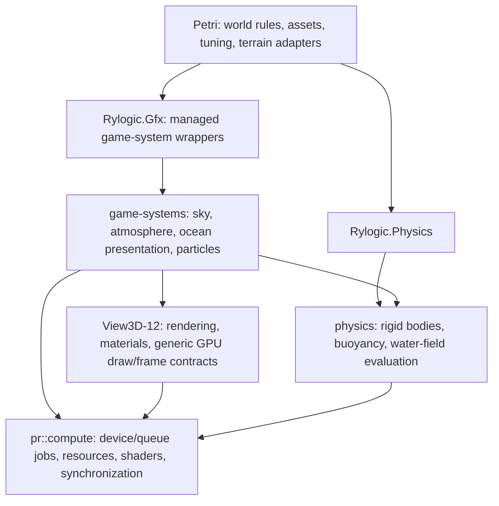
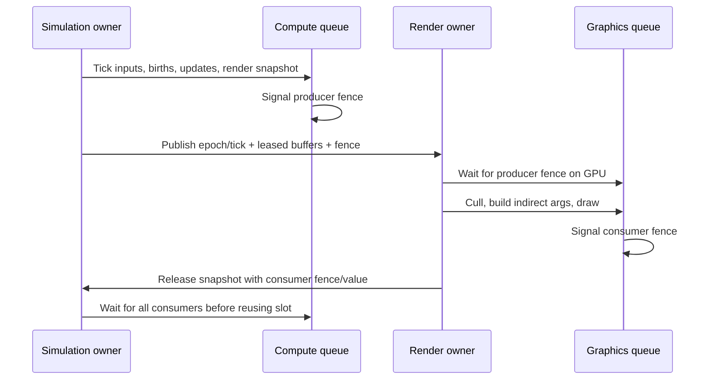

# Reusable game systems and GPU particles

System design and implementation plan for Petri and Rylogic.

**Status:** planning only, 13 November 2026. No implementation, builds, application launches, or repository changes were performed.
Confirmed decisions below are requirements. Proposed APIs and internal layouts are design recommendations, not existing capabilities.

## 1. Confirmed decisions

| Area | Decision agreed with Paul |
|---|---|
| Library | Introduce the native `game-systems` library, depending on View3D-12 and physics, not inside either project. Provide managed interop through `Rylogic.Gfx`. |
| Milestone 0 | Extract the existing reusable sky, water/ocean, and climate/wind systems first. Establish parity before starting particle-system implementation. |
| Tests and demos | Include game-systems tests in the existing `view3d-12-tests` project. Despite its name, the app is both a testing environment and an interactive demonstration app for individual features; do not create a separate game-systems test/demo executable. |
| Lower boundary | Keep rigid-body buoyancy and shared low-level water-sampling maths in physics. Move sky, ocean presentation/weather orchestration, and the atmosphere solver into game-systems. No reverse dependency. |
| Draw batching | One instanced draw per compatible pipeline, batching across emitters, rather than one draw for every emitter or one literal draw for every effect combined. |
| Time | Particle motion and appearance are functions of simulation time or evolve in simulation steps. Slow motion and pause must work. |
| Authority | Particles are visual only. Gameplay fire, weather, beacon meaning, and real birds remain separate simulation state. |
| Persistence | Recreate particles on reload; do not save their GPU state. Recreate persistent emitters from current world state, without replaying expired one-shot events. |
| GPU residency | Keep particle state on the GPU. Upload changed commands and inputs, not complete particle arrays every frame. |
| Extensibility | Support caller-defined particle state layouts and custom HLSL, alongside stock effects. |
| Performance | Characterize representative workloads before setting budgets. Approximately 1,000,000 live particles is a desirable target, not a guarantee for every effect and screen coverage. |
| Exhaustion | Caller-configured pools drop new particles when full and report the count. Existing particles finish normally. No automatic hot-path growth or stall. |
| Collision | Supply simple collision descriptions to GPU kernels; particles do not query or control the physics engine. |

Screen distortion remains a stretch goal. Non-volumetric smoke, dust, precipitation, leaves, distant birds, chips, sparks, fire, ocean spray/froth, and gameplay-marker visuals are in the planned core catalogue.

## 2. What exists today

The design follows the local `petri` and paired `rylogic-code` checkouts. Source references are listed in section 12.

| Existing capability | Consequence for this design |
|---|---|
| View3D owns `ProceduralSky`, weather maps, sky shader bytecode, cloud-shadow integration, and sky history. The forward renderer reads the concrete sky's drift directly. [R1-R3] | Extraction needs an actual rendering boundary change, not just moving files or leaving forwarding wrappers. Cloud shadows and temporal history are part of parity. |
| The atmosphere solver already runs independently on a GPU queue. Its DLL/managed lifetime is nevertheless tied to a physics engine. Its implementation uses a physics wrapper around existing `pr::compute` facilities. [R4-R6] | Move solver ownership and its API out of physics; reuse `pr::compute` rather than creating another compute framework. A climate-only application must not require a rigid-body engine. |
| Atmosphere tracers already stay in GPU buffers with explicit hold/release fences. [R4, P2] | This is useful lifetime prior art. It is not a ready-made generic particle system. |
| Petri's tracer rendering builds six indices for every tracer and decodes logical vertex IDs; it does not use a single instanced quad. [P1] | Do not copy this geometry representation for the new system. Move it unchanged for milestone-0 parity, then replace it after the generic renderer exists. |
| View3D populations already provide GPU classification, indirect instancing, payload buffers, and GPU producers. Their public contract requires opaque materials; producers run at the next render frame. [R7] | Reuse low-level rendering machinery where appropriate, but do not assume populations already support transparent particles or simulation-owned updates. |
| Petri.Native owns the water surface renderer, ripple texture generation, foam shading, and foam history. Water shaders already use physics water-sampling code. Shore foam also depends on Petri's terrain cache. [P3-P4] | Extract reusable surface code while replacing Petri terrain/layout knowledge with explicit caller inputs. Preserve surface foam; do not replace it with millions of particles. |
| `pr::compute::particle_collision` contains older GPU collision code with supplied layouts, but also TODOs and older API usage. [R8] | Inspect useful geometry mathematics before reusing it. It is not evidence that the required particle runtime or collision path is production-ready. |
| Petri slows time by admitting fewer fixed-duration simulation ticks, not by shrinking the step and scaling the velocity again. [P5] | Consume the authoritative tick and step duration. Never apply the slow-motion multiplier twice. |

## 3. Target library boundary

Arrows are dependencies, not runtime call order. Neither View3D nor physics references game-systems.

### Native layout

Use the established static-library/DLL project pattern:

- `include\pr\game-systems\`: public C++ contracts and public HLSL interfaces.
- `projects\rylogic\game-systems\`: implementation, shader resources, and native/DLL projects.
- `projects\tests\view3d-12-tests\`: game-systems tests and interactive feature demos, alongside the existing renderer and View3D UI coverage.
- Namespace `pr::game_systems`; one module `forward.h` for foreign dependencies.
- `game-systems.dll`: explicit C ABI with owned handles, error reporting, documented thread affinity, and matching managed layouts.
- Ship headers, import/static libraries as appropriate, shader includes, and DLL through the existing `Rylogic.Native` package.

Do not create a plugin ecosystem, ECS, feature graph, new asset package format, or another generic GPU scheduling framework for this work.

### Responsibility split

| Owner | Owns | Does not own |
|---|---|---|
| game-systems sky | Atmosphere appearance, clouds, celestial calculations, weather-map generation, cloud-shadow evaluation, sky temporal resources | World day length, gameplay visibility, Petri scene transitions |
| game-systems atmosphere | Air solver, reusable field/probe interfaces, independent GPU lifetime, diagnostic tracers | Petri's dish geometry, weather rules, persistence policy |
| game-systems ocean | Reusable water presentation, wave-weather orchestration, ripples, surface foam/history, inputs for spray | Rigid bodies, Petri terrain recipes, fixed dish dimensions |
| physics | Body dynamics and buoyancy; shared water-field representations, evaluators and bathymetry maths required by those consumers | Sky or particle rendering; ownership of the atmosphere |
| game-systems particles | GPU allocation, emission, evolution, rendering preparation, stock effects, simple collision helpers | Damage, resource gathering, actor identity, gameplay events, physics queries |
| View3D | Generic submission, resource binding, materials, depth/alpha compositing, frame attachment points | Particle lifetime/emission, atmospheric equations, procedural cloud generation |
| Petri | World clock, gameplay event production, emitter attachment, domain/tuning choices, asset selection, terrain-to-field conversion | A private copy of reusable system algorithms |

`Rylogic.Gfx` should expose standalone game-system types, not put every new class inside `View3d`. The assembly location does not make the render thread the owner of all those types. Simulation-facing wrappers accept a device lease and have their own explicit simulation-owner contract.

Moving atmosphere wrappers out of `Rylogic.Physics` must not make `Rylogic.Physics` depend on `Rylogic.Gfx`. Applications compose the two. Petri's existing adapters can consume the new wrappers without adding GPU types to `Petri.World`.

### Renderer seams required by the extraction

Two specific seams are necessary; neither exists in the complete proposed form today.

1. **Caller-owned environment shading.** Replace concrete `ProceduralSky` access with an explicit scene binding for immutable shader variants and their constant/resource payload. Move the procedural cloud equations and their shader recipes into game-systems. View3D provides a neutral lighting hook and compatible forward-material contracts; game-systems supplies the cloud-aware variants at shader preparation time.
2. **Caller-owned frame work/resources.** The sky owns its temporal history and reprojection inputs. View3D exposes the required frame ordering, view/depth information and resource attachment lifetime without owning sky-specific state. Preserve the existing history reset behaviour for viewport changes, reflections and cubemap faces.

This is the highest-risk part of milestone 0. First prove the smallest complete seam against simple, PBR, procedural, population and relevant reflection paths. Do not build a general shader-plugin language. Do not replace the cloud evaluator with an approximate shadow texture just to make the move easy: that would add a separate appearance/performance change to a parity task.

Public View3D HLSL contracts and game-systems shader recipes must support composing the needed variants before gameplay. No per-draw compilation and no circular shader-source ownership.

## 4. Particle architecture

### Main concepts

| Proposed concept | Purpose |
|---|---|
| `ParticleType` | Immutable state/spawn/render layout descriptors, shader program, and required resource bindings |
| `ParticleSystem` | Simulation-owner GPU pools, emitters, lifecycle commands, ordered stepping, publication and diagnostics |
| `ParticleEmitter` | Stable identity plus origin/attachment, seed, rate or burst requests, and type-specific parameters |
| `ParticleFrame` | Immutable GPU render snapshot with simulation epoch/tick, resource leases, and producer completion fence |
| `ParticleRenderer` | Render-owner culling, visible-index construction, indirect arguments, and View3D submission |

A reusable, long-lived GPU execution context uses the existing `pr::compute` device/queue/job machinery. Share it where atmosphere and particles have the same owner and scheduling requirements. Separate contexts remain explicitly synchronized; do not create a queue per emitter or per effect.

The application owns the context and world lifetime. Particle types and materials can be shared across worlds; live pools and emitters belong to a particular system/world epoch.

### Separate simulation state from render data

Use three distinct representations:

1. **System metadata:** slot ownership, emitter identity, allocation/liveness and generation information.
2. **Type-specific simulation state:** caller-defined fixed-stride GPU records, with no universal giant particle struct.
3. **Pipeline-specific render records:** the minimum immutable inputs needed by a compatible draw program.

Stock effect kernels produce a shared stock render-record format wherever their geometry/shading is compatible. This lets fire, smoke and dust sprites from many emitters share a draw, even when their simulation states differ.

A custom type may produce that stock format or declare its own render-record layout and graphics program. Its custom state remains supported either way. A genuinely different graphics program or incompatible resource/geometry binding becomes another batch, not a per-particle CPU path.

Simulation records live in pools grouped by their update program/layout. Render records live in arenas grouped by their draw program/layout; separate simulation pools can write disjoint ranges of the same render arena. The render owner builds one combined visible-index list for those ranges.

Project render data during the final update/publication dispatch where possible. Do not always run a separate full-particle conversion pass. Stateful kernels may update their own slot in place when no reader uses that mutable buffer. Algorithms requiring another particle's previous state need a separate explicit algorithm and buffering contract; inter-particle dynamics are outside the initial system.

This separation costs GPU writes and snapshot memory. It deliberately avoids uploading particle state to the CPU, forcing every effect into a maximum-size state struct, or making graphics read buffers being overwritten by simulation. Measure its cost rather than describing it as free.

### Allocation and emission

- Caller-supplied pool, emitter, command and render-arena capacities; no guessed application limits in reusable code.
- GPU free-slot lists and compact live lists. Dispatch work over live records and requested births rather than repeatedly scanning all capacity where practical.
- GPU continuous emission accumulators use particles per simulated second, retaining fractional births.
- CPU sends emitter creation/removal, changed parameter ranges, timestamped bursts and changed environment inputs. Existing parameters remain GPU-resident.
- GPU producers can generate spawn requests directly, for example from ocean crest/breaking samples.
- Apply commands at defined tick boundaries. Continuous-parameter changes may coalesce before their effective tick; burst events must not silently disappear under a latest-snapshot publication policy.
- Emitter transforms explicitly distinguish particles attached to an emitter from particles released into world space. A moving source must not drag old smoke unless attachment was requested.
- Deleting an emitter stops future births. Draining existing particles and clearing them immediately are distinct explicit operations.
- Pool exhaustion drops new births and increments requested/admitted/dropped counters by type/emitter as appropriate. Never resize or wait for the GPU merely to admit another visual particle.
- Invalid handles, malformed layouts and unsupported shaders are errors, not normal capacity drops. They fail visibly at their owning boundary.

Random seeds derive from stable emitter identity, spawn sequence and caller seed, not from a render-frame number. GPU free-list order is not a promise of bitwise cross-device reproducibility.

## 5. Time, ownership and GPU publication

### One clock, two evolution modes

**Analytic:** evaluate a pure function of initial data, seed, age and declared immutable parameters. Useful for beacon rings, bird flight/flapping loops, some fire animation, and simple ballistic motion without collisions. No recurring CPU position upload or integration is required.

**Stepped:** record compute updates for the simulation's actual elapsed step. Useful for gust-driven smoke, bouncing sparks/chips, leaves and spray. Time-varying external fields require their time history through steps; evaluating `current_wind * age` is not equivalent.

All time-driven properties use the same simulation timeline: position, age, lifetime, birth rate, texture animation, rotation, colour/size curves, noise phase and distortion phase. Rendering never advances simulation.

Petri supplies its tick/duration; the generic library does not hard-code 60 Hz. At pause, no births or evolution occur. Camera movement may change visibility and billboard orientation, but not age or trajectories. At slow motion, Petri admits fewer ticks; do not multiply the duration again by its time-scale setting.

For smooth stepped presentation, stock records may contain previous/current values and identity so the renderer interpolates between completed steps using the host's presentation timestamp. Never interpolate different slot generations. Analytic evaluation uses that same selected timestamp. Do not extrapolate stateful collisions beyond published results.

Use a double/integer host clock and bounded local GPU ages/time origins. Do not convert an ever-growing absolute world time to one float and lose sub-frame precision. Backward seeking/replay is not part of this design; a discontinuous clock/world replacement explicitly resets the particle epoch.

### Queue and buffer contract

The producer may publish before GPU completion, but not without a completion fence covering every resource in the snapshot. Reference counting alone does not make a buffer safe to overwrite.

Keep mutable simulation buffers private. Use a bounded ring of render snapshots. Required ring capacity follows the documented maximum held readers and in-flight writes, rather than silently assuming two buffers suffice. Multi-view rendering shares simulation but has separate view preparation; retire a snapshot only after its last consumer.

If publication is backpressured, continue stepping private state and retain the last valid render snapshot; skip only an intermediate render publication, not simulation ticks or burst input. Expose snapshot age/backpressure. Never overwrite held resources or deadlock a stopped renderer.

Where fields live on another queue, field leases also carry producer completion and consumer-release fences. For atmosphere and particles on the same queue, record field production before consumption. Avoid mutual waits by specifying a one-way tick dependency.

Resource state transitions/UAV barriers, `INDIRECT_ARGUMENT` state, descriptor lifetime and queue fences are all part of this contract. Reuse existing View3D/compute helpers. Do not add a per-frame blocking `ResourceFactory` or full state readback.

Shutdown stops new submissions, releases presentation leases, retires GPU work, and then destroys resources and device/context references. Report device removal explicitly. Device loss and world replacement cannot leave stale handles silently drawing another world's records.

### Petri event bridge

The simulation publishes effect occurrences with a world epoch, sequence/event identity, position and simulation timestamp. The adapter delivers bursts once and retains persistent emitter state separately. The renderer is not an event authority.

On reload, reconstruct emitters for still-existing fires, weather and beacons. Start transient particle pools empty; do not replay old construction/destruction/chopping events. Particle absence must not change damage, colony visibility, resources or other gameplay outcomes.

## 6. Instanced rendering and transparency

### Exact draw-count contract

A **compatible draw batch** shares its render pass/view, graphics program/root binding contract, blend/depth/raster state, geometry/topology and bindable resource set. Material variants that fit the same texture arrays/atlas and per-record parameters need not split a batch.

- Sprites: one shared quad, indexed or vertex-ID generated, instanced with `SV_InstanceID`.
- Streaks: shared instanced geometry stretched from motion; no per-particle CPU mesh.
- Leaves/chips/birds: shared small mesh prototypes or cards. Different mesh prototypes/LODs may require distinct geometry batches.
- GPU culling builds compact visible-index lists and indirect arguments. GPU alive/visible counts never need to return to the CPU to issue the draw.
- Submit one instanced draw per nonempty compatible batch, not per emitter, simulation pool or particle.

`ExecuteIndirect` with many commands is not one draw. Count actual draw commands, grouped by pipeline, geometry and pass. Reflection views, shadow passes if subsequently supported, transparency resolves and a distortion composite are additional work and must be reported separately.

Start with the existing View3D instancing/indirect machinery as prior art. Add or extract the narrow generic GPU-buffer draw submission needed for external instance data and alpha materials. Keep particle allocation, evolution and effect code in game-systems. Do not force particles through population LOD/block semantics merely to avoid a renderer change.

### Alpha integration

Use View3D's existing alpha collection/compositing path for stock translucent particles, including emissive alpha sprites. Preserve its shader-output, depth and resource-state contracts; an alpha-collect shader is not interchangeable with an ordinary `SV_TARGET` pixel shader.

Stock particle sprites test against opaque scene depth, do not write opaque depth, and can soften intersections using linearized scene depth. Use the existing colour/alpha encoding and material lighting conventions.

Dense smoke stresses the K-buffer's finite layers/overflow approximation and pixel cost. Make smoke-in-front-of-water, smoke-in-front-of-smoke and bright sparks-behind-smoke explicit early fixtures. A million tiny particles is not a proxy for these cases.

**Observed in milestone 1:** the demo's smoke shows hard polygonal edges. The K-buffer keeps the 4 nearest transparent fragments sorted and folds the rest into one arrival-ordered, 8-bit overflow colour. Dense smoke has far more than 4 layers, so wherever a nearer sprite's outline crosses a pixel, farther fragments switch between the sorted path and the overflow path and the colour steps along that outline.

**Decision: weighted blended transparency is a general View3D transparency mode, not a particle feature.** It is a render-pipeline concern (targets, pass order, resolve), so it belongs in View3D next to the K-buffer. Any nugget may select it; game-systems only chooses it per particle type.

- Modes, chosen per nugget/material: `Sorted` (the K-buffer, the default and unchanged) and `Weighted` (order-independent accumulation). Opaque and cutout stay as they are.
- `Weighted` suits many overlapping, similar, soft translucent layers where exact order does not matter: smoke, dust, steam, spray and mist, cloud and fog cards, fire glow, light-shaft cards, ghost/placement previews, selection highlights, and dense translucent debug or chart data such as point clouds and atmosphere tracers.
- `Sorted` stays right for few, distinct layers whose order is visible: glass, water surfaces, UI-like panels, sparks and markers.
- Targets: an RGBA16F weighted-colour sum and an R16F revealage per view, for each of two depth groups (see below).
- Pass order: opaque, then K-buffer collection, then weighted accumulation. Weighted fragments test against opaque depth, do not write depth, and read the pixel's nearest K-buffer layer depth to choose a group: behind it or in front of it.
- Resolve (one full-screen pass, `kbuffer_resolve.hlsl`): opaque, then the K-buffer overflow, then the weighted *behind* group, then the K-buffer layers back to front, then the weighted *in front* group.
- Limits: a weighted fragment between two sorted layers composites behind both; there is no order inside a group. Weighted pixels never consume K-buffer layers, which also reduces overflow for sorted surfaces.
- Cost: four extra targets per view (two per group), 20 bytes per pixel in total, plus one accumulation pass and the extra resolve reads. Measure it. Views with no weighted nuggets skip the clear, the pass and the reads.
- Parity: scenes with no weighted nuggets must render identically to today; this is a renderer-wide change and needs explicit no-weighted parity tests.

Additive blending is order-independent and can be expressed in the weighted mode's contract; it does not need a third path. Do not add CPU depth sorting. Emissive appearance does not itself require additive blending.

Particles do not cast shadows or enter ray-traced acceleration structures in the initial scope. Secondary-view participation is explicit; it does not trigger a second simulation step.

### Visibility versus simulation

Culling changes what is drawn, not the underlying stepped trajectory. Renderer bounds are supplied or GPU-derived conservatively; custom shaders that expand geometry own valid bounds.

Do not make the physical climate camera-relative. A bounded moving precipitation window is a possible visual optimization, not part of the authority model; implement it only with stable world-space seeding and camera-motion continuity evidence. Begin with caller-defined world-space emission regions.

## 7. Custom state and HLSL contract

A registered type supplies:

| Descriptor | Contract |
|---|---|
| Simulation and spawn data | Fixed byte stride/alignment per type; caller-owned POD/unmanaged layout |
| Render data | Fixed stride/layout matching its draw program, or the stock sprite/mesh format |
| Initialization/evolution | HLSL routines for birth and, for stepped types, one tick's update |
| Presentation | HLSL projection into render records, plus optional custom vertex/pixel programs |
| Environment/resources | Explicit read-only field/texture bindings and constants; no hidden physics access |
| Lifetime/bounds | Explicit alive/dead result and conservative presentation bounds |

Provide small common HLSL helpers for random sampling, emission shapes, curves, field sampling, plane collision, sprite expansion and the supported View3D alpha output. The stock effects use the same registration path as caller effects.

Use public shared C++/HLSL declarations where practical. Managed layouts require explicit packing/size and round-trip fixture checks. Shader reflection can check reflected bindings and typed layouts; it cannot prove the interpretation of arbitrary raw byte-buffer loads. Do not promise automatic validation of handwritten offsets.

The library owns buffer bounds, allocator operations and dispatch contracts; a user routine operates on its assigned particle and declared inputs. Validate layouts, capabilities and resource shapes at registration/binding boundaries, not repeatedly in each hot-path accessor.

Treat custom HLSL as trusted application code. It can cause GPU faults; this is not a shader sandbox.

Recommended initial workflow: compile shipped shader programs during the build/cook process and register immutable bytecode at startup. Reuse existing DXC/cache facilities for development compilation, with source/layout/binding changes included in cache identity. Shader hot reload, runtime graph editing and visual authoring tools are not prerequisites.

## 8. Environment and collision inputs

Particles read explicit, immutable inputs rather than reaching into other systems:

- Uniform acceleration and wind.
- Optional GPU vector field with documented grid, world-to-field transform, boundary sampling and tick/fence metadata.
- A compact plane set; later, reusable primitives or terrain/water fields when justified by effects.
- Application-selected textures, material curves and spawn-region data.

For a plane, define a normalized normal `n`, offset `d`, and the allowed half-space `dot(n, p) >= d`. A particle of radius `r` keeps its centre at least `d + r` along the normal. Supply restitution and tangential damping explicitly.

For each stepped movement, test the swept segment against relevant planes, resolve the first crossing, and continue the remaining step if permitted by the caller's collision-iteration budget. Only reflect velocity directed into the surface. Define initial-overlap correction and budget-exhaustion behaviour explicitly and expose diagnostics; do not claim a bounded loop guarantees all collisions.

Start with static planes and per-emitter/type collision sets so cost is proportional to the relevant set, not every world plane for every particle. Bounded plane patches or convex plane sets are needed for finite objects; a lone plane represents an infinite surface, not an arbitrary obstacle.

Moving collision proxies need timestamped transforms/surface velocity and an explicit contact model. They are a later extension, not something inferred by sampling mutable physics objects from a particle shader.

Water-attached froth and spray can use the shared water-field sampling contract. Terrain collision uses an application-supplied height field or proxy geometry, not Petri code inside game-systems. Sampling render depth for physical collision is deliberately excluded initially: it misses offscreen/back-facing geometry and makes trajectories camera-dependent.

No particle-to-particle collision, rigid-body solver, physics callback per particle, or gameplay feedback is included.

## 9. Stock effect catalogue

These are presets/programs over the same runtime, not separate emitter engines.

| Effect | Representation and evolution | External inputs |
|---|---|---|
| Ocean spray | Stepped droplets/cards or streaks; gravity, wind and optional water impact | GPU crest/breaking producer, water-field snapshot |
| Froth patches | Surface-oriented sprites following the water; age/fade and drift | Water sampling and surface flow; complements existing surface foam |
| Fire | Animated emissive sprites; seeded flicker/size curves, analytic where sufficient | Emitter transform, authored appearance; no damage logic |
| Sparks | Small streaks/cards; ballistic motion, stepped for bounces | Gravity and simple collision sets |
| Smoke | Non-volumetric flipbook/sprites; rise, drag, wind, scale and opacity curves | Wind field and emitter parameters |
| Destruction dust | Bursts with outward impulse, drag, settling and fade | Timestamped world event, optional planes |
| Rain | Streaks; analytic under constant inputs, stepped when gusts/collisions require it | Weather intensity, emission region, optional wind/ground field |
| Snow | Cards with seeded flutter/rotation and wind-driven drift | Weather region and wind |
| Leaves | Oriented cards or small shared meshes; tumble, flutter and drag | Wind, gravity and optional collision proxies |
| Distant birds | Cards or small shared meshes; seeded flight paths and analytic wing motion | Caller region/path data; no AI/flocking/gameplay bird state |
| Wood chips | Instanced small meshes with angular motion and plane bounces | Chopping event, material/prototype, collision set |
| Gameplay markers | Rings, columns, pulses or sprites evaluated from age | Authoritative marker identity, position and status |
| Screen distortion (stretch) | Instanced distortion contributors plus a separate scene-colour composite | Resolved scene colour/depth and simulation-time phase |

Petri owns when an effect happens and which assets it uses. Reusable stock examples/assets must have suitable redistribution rights and no dependency on Petri's protected asset source or cooker.

Screen distortion must not sample a render target while writing it. Its pass ordering, MSAA treatment and depth rejection need a separate proof; it is not included in the ordinary one-draw-per-batch promise.

## 10. Performance and diagnostics

Set numeric budgets after measuring controlled workloads on the target GPU, resolution, quality settings and normal Petri scene load. Approximately one million live particles is the intended scale to investigate.

Measure separately:

- CPU command generation, marshaling/upload bytes, render submission time and allocations.
- GPU birth/update/collision, snapshot projection, culling/compaction, indirect draws, alpha collect/resolve and any extra passes.
- Live, allocated, visible, born, expired and dropped particle counts.
- Actual draw count and why each batch split occurred.
- GPU memory, snapshot count/age, producer-consumer waits and queue backpressure.
- Screen coverage/overdraw and tail frame times, not only average FPS.

A fixed emitter set with no edits should need only small clock/frame inputs on the CPU. Continuous births and per-particle trajectories remain on the GPU. Diagnostic counter readback is small, delayed and optional; it must not become a mandatory frame synchronization.

**Illustrative sizing, not a chosen layout:** with 1,000,000 particles, 64-byte simulation state, three 48-byte render snapshots and four 32-bit index arrays, the subtotal is 224 MB (about 214 MiB), before textures, allocator metadata, scratch buffers and custom state. A full 60 Hz update reading/writing that 64-byte state and writing one 48-byte render record moves about 10.56 GB/s before other passes. Memory/bandwidth therefore need measurement even when CPU transfers are tiny.

Characterization matrix:

| Workload | What it distinguishes |
|---|---|
| Mostly analytic markers/birds, many emitters | CPU batching and time evaluation |
| 100k then approximately 1m tiny sparks/rain | Update/compaction throughput and draw scaling |
| Same count, few versus many compatible emitters | Confirms draw count follows batches, not emitters |
| Large overlapping smoke/dust | Alpha-layer quality and fill-rate cost |
| Mixed sprites, meshes, textures and custom programs | Real batch split/descriptor cost |
| Wind plus increasing relevant plane counts | Field bandwidth and collision scaling |
| Pause, slow motion, low render FPS, stopped rendering | Clock and publication correctness |
| Repeated bursts at full capacity | Exhaustion semantics and diagnostics |

Tune only after identifying the bottleneck. Start with GPU compaction and shared geometry; add more sophisticated culling, sorting or reduced-resolution effects only when evidence warrants their complexity.

## 11. Implementation milestones

This is an ordered implementation plan, not authorization to begin implementation. Before repository edits, confirm the existing workspaces with Paul. Do not create worktrees, switch branches, commit or push as a side effect of this plan.

### Milestone 0 - Extract game-systems and prove parity

**Hard gate: finish all of milestone 0 before implementing the particle system.** Preserve algorithms, tuning, simulation clocks and visible behaviour during extraction. API stability is not required: update owned callers together instead of retaining compatibility wrappers.

| Stage | Work | Exit evidence |
|---|---|---|
| 0A: baseline and boundary proof | Inventory all consumers in both repositories; establish sky/water/climate scenes, settings, timings and diagnostic outputs. Prototype the minimal generic renderer seams for cloud lighting and history using the current algorithms. Fix the native/managed ownership and package dependency graph. | Reproducible baseline; an acyclic design; proof that moving the sky can preserve all current render paths. If the proposed seam cannot do so, resolve it here rather than calling a partial move parity. |
| 0B: library/package foundation | Add game-systems static/DLL projects, public headers/HLSL, C ABI, `Rylogic.Gfx` wrappers and native packaging/build entries. Wire game-systems dependencies, runtime DLLs and test shaders into the existing `view3d-12-tests` project; reuse its test runner and interactive demo catalogue. Reuse compute/shader-cache machinery and explicit device leases. | Clean package consumer can create/dispose the library; ABI layout/lifetime checks in the existing test app; no consumer source-tree include/link dependencies or separate test/demo executable. |
| 0C: sky extraction | Move sky, celestial/weather-map implementation, cloud shaders and temporal resources. Replace concrete View3D sky access with the proven generic seams. Update managed/native callers and relevant shader families. | Parity for clear/cloudy/night skies, moving/turning clouds, lightning, celestial transforms, cloud shadows, environment capture, reflection views and viewport/history resets. No procedural sky ownership left in View3D. |
| 0D: climate/wind extraction | Move atmosphere solver, shaders, probes, existing tracers and standalone ownership/API. Remove engine-owned atmosphere records and migrated `Physics_Atmosphere*` wrappers. Keep Petri climate inputs/rates/tuning unchanged. | Same flow/probe/tracer behaviour within agreed numerical tolerances; correct independent create/dispose, pause and fenced GPU handoff; no rigid-body engine required. |
| 0E: ocean extraction | Move reusable water surface rendering, ripples, foam/history and weather orchestration. Retain the agreed physics field/buoyancy boundary. Replace dish and terrain-cache assumptions with explicit domain, sampling and resource inputs; update owned callers. | Same wave samples and body buoyancy, shore/crest/history foam, calm/storm appearance, underwater effects, reflections, lab/world transforms and paused water. |
| 0F: integrated parity and removal | Consume matching packages in Petri; establish sky, water and climate test/demo coverage in `view3d-12-tests`, and migrate affected physics-sandbox and lost-at-sea callers. Remove superseded implementations/API state/build resources, not just unused includes. Update owning architecture/design/build docs. | Paul verifies appearance against the baseline. Numerical, lifecycle and relative-performance evidence meets thresholds agreed in 0A. Individual extracted systems can be exercised in the existing test/demo app. Packages work without sibling source trees. No dual implementation or reverse dependency remains. |

Status: 0A-0F implemented on `pr/particles` in rylogic-code and petri (not pushed); awaiting Paul's visual parity check before particle work starts.

Stages 0C-0E follow the foundation and boundary proof; execute them in that order to keep integration comprehensible. The parity matrix includes feature combinations, not just separate isolated systems. For example, cloud shadows over rough water with climate wind must still agree.

Existing diagnostic tracers move as-is during this milestone. They are not redesigned into the new particle runtime before the gate.

### Milestone 1 - GPU-resident vertical slice

Implement type registration, explicit emitter/system ownership, GPU slots/live/free lists, commands, continuous emission and bursts, simulation clocks, fixed capacities and reported drops. Add bounded immutable render publication with fences.

Use one simple sprite effect with an automated fixture and an interactive feature demo in `view3d-12-tests`, independent of Petri. Implement the minimal generic View3D instanced GPU-buffer submission path and draw one shared quad for all compatible emitters.

**Exit:** many emitters still produce one actual instanced draw in one view; no per-particle CPU updates/readback; pause/slow motion and world reset are correct; lifecycle and queue debug checks are clean. Record an initial scaling curve rather than waiting until the catalogue is complete.

### Milestone 2 - Extensible layouts and production rendering

Prove at least two differently sized simulation records sharing a stock draw format, plus a custom render-record/HLSL program. Add GPU visibility compaction and indirect counts, opaque/cutout and alpha integration, soft depth intersections, and shared small-mesh prototypes. Add View3D's `Weighted` transparency mode (section 6) with its depth-grouped resolve, and make the stock smoke/dust types use it; prove no-weighted parity first.

Make batching keys/resource grouping explicit. Verify C++/HLSL/managed layouts, shader errors, conservative bounds and material/texture variation.

**Exit:** unrelated custom types work without changing the engine's particle struct or adding an effect-specific CPU loop. Compatible pools merge; incompatible pipelines split transparently. Smoke/sparks/water compositing is correct to the renderer's documented alpha quality, and dense smoke shows no layer-overflow edges.

### Milestone 3 - Stepped forces, collisions and environment fields

Add stock gravity/drag, wind-field bindings, swept static-plane collision, per-emitter collision sets, field leases and explicit collision-budget diagnostics. Reuse extracted atmosphere and water field contracts.

**Exit:** bounce/contact fixtures cover oblique impacts, particles moving away, initial overlap and multiple contacts. Equal elapsed simulated time gives equivalent trajectories under normal/slow presentation within numerical tolerance. Camera motion does not change trajectories; there are no physics queries per particle.

### Milestone 4 - Stock effect catalogue

Build fire, sparks, non-volumetric smoke, dust, rain/snow, leaves, distant birds, wood chips and marker presets on the same registration path. Add curves/flipbooks and example appearance assets only as needed by these effects.

**Exit:** every core catalogue row has a fixture, an individually selectable demonstration in `view3d-12-tests`, and documented inputs; analytic/stepped selection is justified by its behaviour. Stock presets do not become independent runtime implementations.

### Milestone 5 - Ocean spray and froth

Add GPU crest/breaking emission, spray motion and water-impact behaviour, plus water-attached froth patches. Retain the existing surface-foam representation for continuous coverage.

**Exit:** no CPU readback is needed to emit spray; moving waves and visual droplets share simulation time/field inputs; the transition between surface foam and sparse particles is convincing and bounded in cost.

### Milestone 6 - Petri integration and tracer consolidation

Connect simulation-owned occurrences and persistent emitters to Petri gameplay/presentation. Add F3 controls and diagnostics using existing development paths. Rebuild persistent emitters on load, clear world epochs correctly, and keep all particle state out of saves.

Replace the moved diagnostic tracer draw geometry with the generic instanced path once colour/size and field-advection behaviour are equivalent. Consolidate its allocation/evolution with the particle runtime only where that preserves its diagnostic contract; do not force a diagnostic solver algorithm into a mismatched abstraction.

**Exit:** marker effects, chopping chips, weather and representative destruction/fire triggers work from real application state or explicit diagnostic fixtures where gameplay triggers do not yet exist. Reload does not replay old bursts. A non-Petri fixture still works from packages alone.

### Milestone 7 - Million-particle characterization and stabilization

Run the workload matrix through configurable particle scenes in `view3d-12-tests`, with roughly one million live particles where meaningful, then measure alongside representative Petri scene load. Set per-workload CPU/GPU/memory budgets with Paul from those measurements. Address measured bottlenecks without relaxing clock, lifetime or batch-count contracts.

**Exit:** publish measured capacity/frame-time envelopes, memory and bandwidth accounting, batch counts and alpha-quality limits. Distinguish tiny-particle throughput from large-smoke coverage. Document achievable settings rather than claiming universal million-particle performance.

### Milestone 8 - Screen distortion, optional

Implement the separate distortion accumulation/composite path only after the core is stable. Prove scene-colour lifetime, depth rejection, compositing order and slow-motion behaviour.

**Exit:** sound-wave/heat-style distortions work without changing gameplay or breaking ordinary particle batching. Extra passes and their cost are explicit.

### Validation policy during implementation

**Shared test and demo home:** `projects\tests\view3d-12-tests\view3d-12-tests.vcxproj` hosts the native game-systems tests and interactive demonstrations. Its name is not a restriction to renderer-only tests; it already includes View3D UI tests and an interactive feature catalogue. [R10] Keep the existing project/executable name.

Group new automated coverage under a game-systems test area, and register sky, ocean, climate and particle demonstrations with the existing interactive catalogue. Reuse the app's window, camera, controls, test support and shader-build facilities rather than introducing a second harness. Share fixture setup between automated checks and interactive demos where useful, without making tests depend on user input or forcing them to launch the interactive mode.

The test app is the standalone, non-Petri proving ground throughout the milestones: extraction parity, individual effect inspection, custom HLSL/layout examples, collisions, slow motion and scale characterization. Petri integration tests and package-only consumption checks remain complementary; the in-repository test app's linkage alone does not prove package completeness. When wiring native dependencies, follow the project's explicit static-library/import-library and runtime-DLL conventions; adding a `ProjectReference` alone does not link a static library in this repository.

Develop/build in Debug with the established VS 2026/v145 and package workflow. Run focused newly added/modified tests during iteration; use direct GPU/numerical/visual parity evidence for extraction. Use Release only for the explicit performance measurements. Full project tests are required on final code before merging, not at every intermediate edit.

Hold the mandatory shared machine load lease for builds/tests/apps and exclusive lease for profiling. Do not profile alongside another session's heavy work. Ask Paul to verify appearance by default; automate captures only for the reproducible evidence required by the parity/performance fixtures.

## 12. Source anchors and remaining engineering proofs

Paths under **Petri** are relative to `E:\Rylogic\petri`; **Rylogic** paths are relative to `E:\Rylogic\rylogic-code`.

| Ref | Source |
|---|---|
| R1 | Rylogic `include\pr\view3d-12\scene\procedural_sky.h:15-153` - sky settings, concrete ownership, cloud shadow and temporal inputs |
| R2 | Rylogic `projects\rylogic\view3d-12\src\render\render_forward.cpp:642-710` - sky history directly accesses the concrete sky |
| R3 | Rylogic `projects\rylogic\view3d-12\src\shaders\shader_forward.cpp:191`; `src\shaders\hlsl\forward\forward.hlsl:97-101`; `src\shaders\hlsl\sky\cloud_field.hlsli:297-353` beneath the same project - cloud shading integration |
| R4 | Rylogic `include\pr\physics\atmosphere\atmosphere.h:295-415` - solver and four-slot tracer publication contract |
| R5 | Rylogic `projects\rylogic\Rylogic.Physics\src\Atmosphere.cs:6-22`; `projects\rylogic\physics\src\dll\interop.cpp:271-306,425-426` - engine-associated wrapper/ownership versus separate GPU state |
| R6 | Rylogic `projects\rylogic\physics\src\utility\gpu.h:6-38`; `include\pr\compute\gpu_job.h:67-71,105-126` - existing shared compute facilities |
| R7 | Rylogic `include\pr\view3d-12\view3d-dll.h:1810-1874` - opaque populations, updates and render-frame GPU producers |
| R8 | Rylogic `include\pr\compute\particle_collision\particle_collision.h:17-106` - existing collision helper, limitations and API shape |
| R9 | Rylogic `build\nuget\Rylogic.Native.Dev.vcxproj:38-64`; `projects\rylogic\Rylogic.Gfx\Rylogic.Gfx.csproj:27-31`; `projects\rylogic\Rylogic.Physics\Rylogic.Physics.csproj:30-33` - package and managed dependencies |
| R10 | Rylogic `projects\tests\view3d-12-tests\view3d-12-tests.vcxproj` - existing automated renderer/UI tests, interactive demo sources, explicit native linkage and runtime DLL deployment |
| P1 | Petri `native\Petri.Native\src\petri_native.cpp:4253-4342` - expanded tracer indices and logical vertex IDs |
| P2 | Petri `adapters\Petri.Rendering.Rylogic\src\RylogicRenderer.Climate.cs:119-188` - resource leases and graphics-fence release |
| P3 | Petri `native\Petri.Native\src\petri_native.cpp:3133-3230`; `native\Petri.Native\src\water_buffer.hlsli:5-86` - water ownership/data and shared sampling |
| P4 | Petri `docs\design\terrain-system.md:140-220` - shared wave clock/physics, wind, ripple and surface-foam contracts |
| P5 | Petri `src\Petri.Runtime\src\FixedStepAccumulator.cs:41-69` - slow motion changes tick admission, not step duration |
| P6 | Petri `docs\design\climate-system.md`; `docs\architecture\technical-architecture.md`; `docs\development\build-test-package.md` - ownership, implemented/proposed climate features, package consumption |

The following are planned engineering proofs, not unresolved product requirements:

- Exact shape of the minimal environment-shader/frame seam, especially all existing cloud-shadow consumers, must be proven in 0A.
- Complete consumer/test inventory must be refreshed when implementation begins; the inspected callers are not a claim of exhaustive impact analysis.
- Final particle record sizes, pool capacities, snapshot count and collision iteration budgets follow measured workload needs and caller contracts.
- Hardware/shader capability requirements must be derived from the chosen kernels and binding strategy; do not impose new bindless requirements unnecessarily.
- Numerical/visual/performance parity thresholds are agreed from the captured baseline before extraction, and particle budgets from characterization before claiming performance completion.

**Complexity outcome:** milestone 0 is consolidation with removal of superseded ownership/APIs; particles are a new subsystem whose growth is justified. The end state has one implementation of each environmental system, one particle runtime, stock and custom effects using the same contracts, and no Petri-specific engine fork or permanent compatibility layer.

## Milestone 0 implementation decisions (revised during execution)

- `game-systems` is a static C++ library (`game-systems-static.lib`) layered on the view3d-12 and compute C++ APIs. A separate `game-systems.dll`
  over View3D's C ABI was rejected: physics-sandbox, lost_at_sea and view3d-12-tests use the sky/atmosphere through the static C++ libraries, and a
  DLL that statically linked view3d-12 would duplicate renderer state for DLL consumers.
- `view3d-12.dll` is the composition root for DLL consumers: it links `game-systems-static.lib` and exports the game-systems C ABI, so Rylogic.Gfx keeps
  one native renderer DLL. The view3d-12 static library never depends on game-systems.
- View3D keeps the cloud-shadow lighting contract (CloudConstants, cloud_field.hlsli, sky history, SkyTexture table) and exposes it through a small
  `ICloudSky` C++ interface that the scene and forward renderer consume. `ProceduralSky`, `WeatherMap`, `CelestialClock` and the sky HLSL move to game-systems.
- Order: scaffold -> sky -> ocean -> atmosphere (the atmosphere ABI is coupled to physics engine handle/owner infrastructure, so it moves last).

## Milestone 1 implementation decisions

- **Graphics-queue simulation.** `ParticleSystem` records its emit/update/compact/args compute passes on View3D's graphics queue through a retained
  `ResourceFactory` (the same mechanism as `ProceduralShader::BufferDispatch`). In-order queue execution orders simulation before every later frame's draw,
  so the snapshot ring and cross-queue fences in section 5 are not needed while simulation and rendering share a queue. The render records are written by
  the final update dispatch and read by the following draws; the next tick's writes are ordered after those draws by the queue. Async compute and a
  snapshot ring are deferred to milestone 7, and only if measurements justify them.
- **View3D seam: per-nugget indirect draw arguments.** `NuggetDesc::m_draw_args` (buffer + offset) makes the forward, shadow and raycast passes issue one
  `ExecuteIndirect` with a single DRAW or DRAW_INDEXED argument whose instance count is written by the GPU. The draw signatures move from the population
  culler to the renderer. A C ABI setter (`View3D_ObjectNuggetDrawArgsSet`) lets DLL consumers use the same seam.
- **Rendering.** The type supplies a triangle list of logical vertex ids drawn for each particle (the stock sprite is a soft disc of 8 rim triangles: opaque centre, transparent rim); `SV_InstanceID` selects a compact live render record. All emitters of a type share one nugget and
  therefore one instanced draw per pass. Particles render through alpha collection with `GeometryHasAlpha | ShadowCastExclude`.
- **API.** The C++ API (`pr::game_systems::particles`) and a C ABI in `view3d-dll.h` (`View3D_ParticleSystemCreate/Destroy`, `View3D_ParticleSpriteShaders`, `View3D_ParticleTypeCreate`, `View3D_ParticleEmitterCreate/Update/Burst/Delete`, `View3D_ParticleSystemStep/Reset`, `View3D_ParticleStats`). The tests and demo use the ABI. The managed wrapper is added with Petri integration.
- **Clock.** `Step(dt)` takes simulated seconds supplied by the host; pause is simply not stepping. Each tick applies queued commands first, then emits,
  then updates. Ages are float seconds per particle; the system epoch increments on `Reset`. `Step(0)` is a pause: it does no work, so bursts are admitted only by positive steps and burst particles are born at the end of that step with age 0.
- **Type constants.** Constants are zero-padded to `ProceduralBinding::ConstantsSize` (1024 bytes), because the procedural vertex path binds exactly that size.
- **Statistics.** `View3D_ParticleStats` reads the counters back with a blocking wait. It is for tests and diagnostics, not per-frame use.

### Milestone 1 status

- Done (`pr/particles-m1` in rylogic-code): GPU-written nugget draw args and its ABI; the particle runtime, sprite type, kernels and ABI; GPU tests
  `GameSystems_ParticleRender`, `GameSystems_ParticleTimeStep` and `GameSystems_ParticleCapacity` (rendering, pause invariance, reset, step-rate
  invariance of images and continuous emission, lifetimes, freeing and drop counts; debug layer clean); the interactive `particles` demo (sparks,
  smoke, fire, bursts, a stress grid of up to 1024 emitters, time scale with pause and slow motion, live pool statistics).
- Outstanding exit items: an initial scaling curve (live count against GPU time, Release build, exclusive load lease, needs a GPU-timer harness), and a
  direct draw-call count check (one object and one nugget per type implies one indirect draw per pass, but it is not yet measured).
